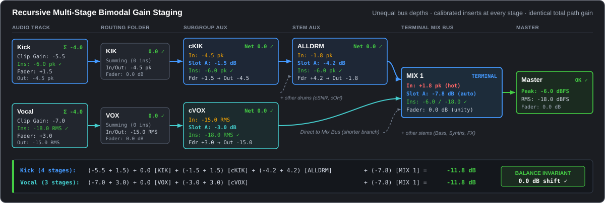

# SessionPrep

Batch audio preflight, peak-capped RMS normalizer, and recursive multi-stage DAW gain-staging tool for mix session preparation.

SessionPrep audits raw multitracks for technical problems, calibrates track levels for predictable insert drive while preserving the incoming file-level balance (the rough mix when multitracks were exported post-fader), and — for Pro Tools templates — extends that same static compensation recursively across every subgroup, stem, and mix bus in your routing graph as an initial linear starting point before you ever press Play.

Conceptually, it works a bit like **Automatic Delay Compensation (ADC) for static gain structure**: each track and insert-bearing bus gets the pre-insert trim its plugins expect (e.g., to reach an initial target level per bus), paired with an inverse post-insert fader so every path from leaf track to Mix Bus accumulates the exact same net linear gain.

> This is a **deterministic preflight and starting-point generator** — not a dynamic real-time AGC, not an AI auto-mixer, and not a non-linear plugin simulator. Bus trims are **initial linear estimates** computed from incoming file levels assuming unity pass-through for unsimulated active inserts and initial fader positions; once you move faders, add non-unity track plugins, or drive FX sends, downstream bus levels will naturally shift.



- Every insert chain (`Kick`, `Vocal`, `cKIK`, `cVOX`, `ALLDRM`, `MIX 1`) starts at its Peak-Capped RMS target (`-18 dBFS RMS` capped at `-6 dBFS peak`, initial linear estimate), and `MIX 1` stays below pre-fader overload with its fader at `0.0 dB`.
- Each track arrives at `Master` shifted by the exact same `-11.8 dB` (`-4.0 dB` shared leaf headroom shift + `-7.8 dB` `MIX 1` trim → `0.0 dB` relative incoming-balance change), even though `Kick` passes through more bus tiers than `Vocal`.

## Screenshots

<table>
  <tr>
    <td width="33%">
      <a href="https://github.com/user-attachments/assets/5cc16b4a-a43b-44c8-8716-ecd771a61972">
        
      </a>
    </td>
    <td width="33%">
      <a href="https://github.com/user-attachments/assets/87af84e9-b704-418a-9258-ff3f4d8ca38a">
        
      </a>
    </td>
    <td width="33%">
      <a href="https://github.com/user-attachments/assets/f6632479-fc35-4b0d-9098-edc937e2767e">
        
      </a>
    </td>
  </tr>
  <tr>
    <td width="33%">
      <a href="https://github.com/user-attachments/assets/690c7a0c-0943-4d3c-8bac-e4329a392fdb">
        
      </a>
    </td>
    <td width="33%">
      <a href="https://github.com/user-attachments/assets/b629009f-1b9e-4650-8036-2940be348a1c">
        
      </a>
    </td>
    <td width="33%">
      <a href="https://github.com/user-attachments/assets/54a0bcaf-4241-4d65-a661-168c96b9dcb8">
        
      </a>
    </td>    
  </tr>
</table>

---

## How It Works

SessionPrep operates in three phases:

| Phase | Name                   | What happens                                                                                                                                                                                                                                                                                                                                                                                                              | When                           |
|-------|------------------------|---------------------------------------------------------------------------------------------------------------------------------------------------------------------------------------------------------------------------------------------------------------------------------------------------------------------------------------------------------------------------------------------------------------------------|--------------------------------|
| **1** | Track Layout           | Define how source tracks map to output files: channel routing, reordering, splitting, merging. Recommends layout cleanups from Phase 1 diagnostics (dropping silent files, extracting active channels from dual-mono and one-sided silence). Drag-and-drop between input/output trees with optional recursive subfolder scanning. Writes outputs to `sp_01_tracklayout/` and peak caches to `sp_peaks/`. | GUI Phase 1 (always available) |
| **2** | Analysis & Preparation | Format checks, digital clipping, DC offset, stereo compatibility, silence, subsonic/ultrasonic content, unweighted RMS anchor & governing/next-highest peak measurement, tail exceedance, and optional corrective repairs (DC, subsonic, ultrasonic). Computes track-level Peak-Capped RMS normalization and inverse fader offsets; optionally writes prepared WAVs to `sp_02_prepared/`. | GUI Phase 2 / CLI              |
| **3** | DAW Transfer           | Transfer tracks into DAW sessions with per-track naming, folder assignment, and unattended batch queuing. DAWproject exports self-contained archives with embedded audio, fader offsets, and empty-folder cleanup. Pro Tools transfers automate folder output routing, `No Input` clearing, empty folder/VCA/orphaned Aux cleanup, VCA-linked folder Groups, two-level Clip Gain + Track Fader staging, and recursive multi-stage Peak-Capped RMS bus gain staging with an offline Signal Flow inspector. | GUI Phase 3 |

### Diagnostics & corrective repairs

Findings are organized into four categories: **PROBLEMS** (clipping, format/length mismatches), **ATTENTION** (DC offset, subsonic/ultrasonic energy, silence, tail exceedances), **INFORMATION** (stereo compatibility, dual-mono), and **CLEAN**.

In Phase 2, **Track repairs…** lets you enable whole-track DC, subsonic, or ultrasonic filters per track or via presets, audition **Original** vs. **Corrected** in the waveform/spectrogram preview, and verify that the rechecked finding clears (`✓ Correction applied`). For every detector and GUI control detail, see [REFERENCE.md](REFERENCE.md).

### Track-level Peak-Capped RMS normalization

Rather than guessing track classes with brittle heuristic thresholds, SessionPrep applies one continuous, deterministic **Peak-Capped RMS** rule to every track:

```text
gain = min(target_rms - rms_anchor, target_peak - sample_peak, max_gain_db)
```

- **Target RMS (`--target_rms`, default `-18 dBFS`):** Anchored to loud chorus sections (default P95 of gated 400 ms unweighted RMS windows), driving sustained vocals, guitars, basses, 808s, and compressed drum loops into a consistent operating range for level-sensitive inserts.
- **Peak ceiling (`--target_peak`, default `-6 dBFS`):** Automatically caps high-crest transients (acoustic kicks, snares, percussion) whenever effective crest exceeds `target_peak − target_rms` (`12 dB` at default targets), preserving clean transient headroom without clipping.
- **Safety guards:** Tracks at or below `-70.0 dBFS` peak hold at `0.0 dB` (**Noise Floor Hold**), and automatic boost is bounded by `--max_gain_db` (default `+24.0 dB`, max `+36.0 dB`) so room tone or dither never winds up.
- **Explicit per-track & pattern overrides:** Force **Peak** mode (via Phase 2 Mode dropdown or `--force_peak <regex>`, e.g. `kick|snare|tom`) when a drum chain expects fixed peak levels, force **RMS** mode (bypassing the peak ceiling with lazy oversampled `dBTP` headroom warnings) when one isolated plosive caps a vocal, or choose **Skip**.

Each gain adjustment is paired with an inverse fader offset so the incoming file-level balance is preserved (matching the producer's rough mix when multitracks were exported post-fader, or matching a raw unity import when tracks were exported pre-fader at unity).

### Recursive multi-stage bus gain staging (Pro Tools & DAWproject)

Calibrating individual tracks does not keep summed subgroups, stems, or the mix bus at target level: a few quiet tracks summed onto a subgroup can under-drive bus inserts, while many tracks summed onto a drum bus or mix bus can overload them.

When transferring to a Pro Tools or DAWproject mix template, SessionPrep reconstructs the template's routing DAG (`Audio → Routing Folders → Subgroup/Stem Busses → Mix Bus → Master`), sums the time-aligned, gain-adjusted Main Output audio in `float64` topological order (accounting for pan law, mono/stereo adaptation, mutes, and VCAs), evaluates the same Peak-Capped RMS rule at each summing node, and applies compensation across every bus tier:

- **Pure summing folders** (zero inserts) stay at `0.0 dB` unity.
- **Intermediate insert-bearing busses** set a validated pre-insert trim plugin (**DMG Audio TrackControl**, **Avid Trim** in default `+6 dB` mode on Pro Tools, or **Process.Audio Protility** — AAX Slot A on Pro Tools; VST3-only Slot 1 on DAWproject, excluding VST2) to `+g` pre-insert, paired with an inverse `-g` post-insert Bus Fader offset (or pre-insert trim with unity faders in `clip_gain_unity` / `trim_unity` mode).
- **Terminal Mix Bus** applies a single attenuate-only pre-insert trim with its fader at unity (`0.0 dB`), protecting post-terminal serial Mix Busses and `Master`.
- **Missing or blocked trim slot handling:** On Pro Tools, if a required staged bus has an empty Slot A and needs non-zero staging, SessionPrep clones the template's most-used clean matching-format (`Mono`/`Stereo`) Slot A trim plugin into Slot A automatically; if Slot A is occupied by a non-trim plugin, transfer stops with an error rather than silently falling back to post-insert faders. On DAWproject, verified VST3 Trim donors (`TrackControl` / `Protility`) are cloned into Slot 1 at unity (`0.0 dB`) by default unless experimental `.vstpreset` gain patching (`dawproject_apply_trim_gain`) is explicitly enabled.
- **Offline `.ptxt` template inspection & pure offline `.ptx` session creation (default):** When a local Pro Tools `.ptxt` template is accessible (either in `~/Documents/Pro Tools/Session Templates/` on Windows/macOS or via an explicit `.ptxt` path configured per template on Windows, macOS, or Linux), Phase 3 **Fetch** and **Signal Flow** preview read the template structure offline without launching Pro Tools. By default, **Transfer Mode** uses **Offline .ptx Writer** (`protools_transfer_backend = "offline_ptx"`), creating complete Pro Tools `.ptx` sessions and BWF/UMID-linked `Audio Files/` folders directly on disk without PTSL or a running Pro Tools instance (with **Live PTSL + .ptx Hybrid** selectable in Preferences).
- **Initial linear estimate & model boundaries:** While algebraic balance invariance (`Δ_bus = 0.0 dB`) is exact at session open, bus input levels and trim values are **initial linear estimates** — they reflect incoming file levels (which equal the rough mix only when multitracks were printed post-fader; unity exports calibrate busses to the unity tracking sum), assume unity pass-through for unsimulated active track/bus inserts (flagged in the Signal Flow inspector with `N active inserts unsimulated ⓘ`), exclude post-fader FX sends, and will naturally shift once you adjust faders or non-unity plugins during mixing. Active **pre-fader sends** tap after Clip Gain / Trim and before the inverse fader and are flagged explicitly in the Signal Flow balance validator.

#### Why this runs offline instead of as a plugin

1. **Plugins cannot see the mixer DAG or write DAW controls:** Standard AAX/VST3/AU plugins (including ARA2) only see their own track/clip buffer — they have no visibility into the bus routing graph and cannot set native Clip Gain or Track/Bus Faders.
2. **Multi-tier sums cannot settle in one real-time pass:** Downstream stem and mix busses depend on upstream subgroup levels; real-time plugins require playing the entire song through (and re-playing if upstream stages change).
3. **Host-level offline visibility:** By working directly on the source PCM files and the DAW session/template file (`.ptx`/`.ptxt` + PTSL, or `.dawproject`), SessionPrep computes, verifies, and applies the complete gain structure atomically before mixing starts.

For the full engineering background, see [TECHNICAL.md](TECHNICAL.md). For complete Pro Tools transfer and parameter details, see [REFERENCE.md §9](REFERENCE.md#9-pro-tools-transfer-automation-ptx--ptsl).

---

## Installation & Quick Start

### 1. Download standalone executables (recommended, no Python required)

Download `sessionprep-gui` (GUI) or `sessionprep` (CLI) from the releases page.

| Executable        | Description                                                  |
|-------------------|--------------------------------------------------------------|
| `sessionprep-gui` | GUI application (interactive analysis, waveform, DAW transfer) |
| `sessionprep`     | Command-line tool (scripting, batch workflows, CI)           |

The All Platforms workflow produces one Windows installer (native x64/ARM64), separate macOS ARM64/Intel DMGs, and Linux packages for both architectures. See [build and release details](packaging/github/README.sessionprep.md).

### 2. Run from source (optional)

```bash
git clone <repo-url>
cd sessionprep
uv run --extra gui python sessionprep-gui.py             # run the GUI
uv run --extra cli python sessionprep.py /path/to/tracks # run the CLI
```

See [DEVELOPMENT.md](DEVELOPMENT.md) for full development setup, building, and architecture details.

### 3. Typical workflow

1. **Launch `sessionprep-gui`** and open a multitrack directory.
2. **Phase 1 (Track Layout):** Review layout recommendations (silent drops, dual-mono splits, unassigned channels) and click **Apply** if you want cleaned/routed source files.
3. **Phase 2 (Analysis & Preparation):** Review **Summary** and per-track **File** findings (use **Visualize**, **Help**, **Track repairs…**, or **Alt+Shift** multi-track batch edits as needed), then click **Prepare** if you want gain-baked/repaired WAVs.
4. **Phase 3 (DAW Transfer):** Choose Pro Tools or DAWproject, assign tracks to template folders, inspect the offline **Signal Flow** preview (with optional per-bus fader overrides), and click **Create**.

### Configuration & logging

- **Preferences (`File → Preferences`):** Stored in `sessionprep.config.json` in your user config directory (`Global` tab for HiDPI scale, project directory, colors, and group presets; `Config Presets` tab for named Analysis/Detector/Processor/DAW parameter presets).
- **Session overrides:** Phase 2 **Config** inherits from the selected preset and tracks per-session overrides with blue change markers; individual reset buttons or **Revert to Preset** restore preset values. DAW and report display changes apply immediately without reanalysis.
- **Logging:** A rotating log file (`sessionprep.log`) is written to the same config directory. Set `SP_LOG_LEVEL` to `DEBUG`, `INFO` (default), `WARNING`, or `NONE` to control verbosity.

---

## Usage Examples (CLI)

### Basic analysis (dry-run, read-only)
```bash
sessionprep /path/to/tracks
```

### Execute processing (writes to `processed/`)
```bash
sessionprep /path/to/tracks -x
```

### Apply corrective repairs to matching tracks
```bash
sessionprep /path/to/tracks --fix dc --fix subsonic --low-cut-hz 10 --execute
```

Omit `--execute` to review selections first. Add `--fix ultrasonic` for eligible high-rate files.

### Force peak targeting by track name & cap maximum boost
```bash
sessionprep /path/to/tracks -x --force_peak "kick|snare|tom" --max_gain_db 18
```

### Hotter calibration (modern plugins)
```bash
sessionprep /path/to/tracks -x --target_rms -16
```

### Safety-first RMS anchor (strict max window)
```bash
sessionprep /path/to/tracks -x --rms_anchor max
```

### Tune the relative gate (sparse tracks)
```bash
sessionprep /path/to/tracks -x --gate_relative_db 30
```

### Anchor track (keep one fader at 0 dB)
```bash
sessionprep /path/to/tracks -x --anchor "Kick"
```

### Custom report filenames
```bash
sessionprep /path/to/tracks -x --report my_report.txt --json my_report.json
```

### Group related tracks (identical gain)
```bash
sessionprep /path/to/tracks -x --group Kick:kick,kick_sub --group OH:overhead,oh --group Toms:tom
```

Groups use `Name:pattern1,pattern2` syntax. Patterns support substring, glob (`*`/`?`), or exact match (suffix `$`). First match wins; if a file matches multiple groups a warning is printed.

---

## Documentation

| Document                         | Contents                                                         |
|----------------------------------|------------------------------------------------------------------|
| [README.md](README.md)           | Overview, mental model, installation, quick start, CLI usage     |
| [REFERENCE.md](REFERENCE.md)     | Detector reference, analysis metrics, GUI controls, Pro Tools `.ptx` automation |
| [TECHNICAL.md](TECHNICAL.md)     | Audio engineering background, Peak-Capped RMS & multi-stage gain-staging theory |
| [DEVELOPMENT.md](DEVELOPMENT.md) | Development setup, building, library & `.ptx` architecture       |
| [KANBAN.md](KANBAN.md)           | Backlog and planned features                                     |

---

## License

LGPL-3.0-or-later. See [LICENSE](LICENSE).
